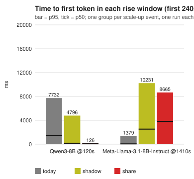
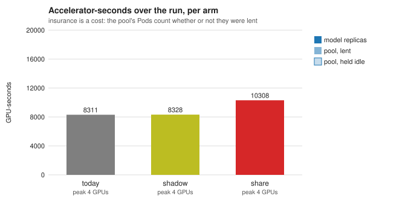
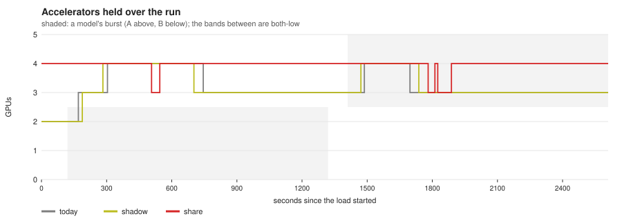

# What sharing one quota did, measured

[← Share one GPU quota between models](README.md)

Two models behind one gateway take turns at bursting, under **one** namespace
quota that is smaller than their two peaks together. The same traffic ran
three times, and only the policy's `optimizer:` block differed between the
runs:

- `today`: no block, so today's optimizer runs;
- `shadow`: the utilization-share optimizer computing and moving nothing;
- `share`: the same optimizer acting.

There was one run of each arm on H200 nodes, on 2026-10-08. The image was built
from `259c52f8` and deployed by digest. The scenario and the guards that keep
the arms comparable are in the
[benchmarking runbook](../../guides/benchmarking/two-model-utilization-share.md).
The tables below are that report's, unedited, except where a row says it came
from the controller log. Five later runs, on a scenario with different burst
shapes, follow in
[their own section](#different-burst-shapes-a-cancel-that-stalled-the-rising-model);
they found failures the first scenario could not show. Three runs with both models
[P/D-disaggregated](#pd-two-disaggregated-models-under-one-quota) close the
page. Every run used 1 GPU per replica.

## The setup

| | |
| --- | --- |
| models | `unsloth/Meta-Llama-3.1-8B-Instruct` (A), `Qwen/Qwen3-8B` (B). Each has its own InferencePool and EPP, and each replica gets 1 × H200 |
| quota | `H200: 4`, one namespace quota for both models (`WVA_LIMITER=quota`) |
| bounds | each model 1–3 replicas in every arm. The two peaks together want 6, so the quota is binding |
| load | inference-perf, Poisson open-loop, 1000 in / 500 out tokens, synthetic prompts |
| rates | 3 rps between bursts. Bursts reach 9 rps for A and 8 rps for B, and A and B never burst at once |
| schedule | 120 s lead-in, B bursts for 1200 s, a 90 s band, then A bursts for 1200 s. That is 2610 s and 28 860 requests per arm |
| HPA | the shipped defaults: a 300 s scale-down window |

## What each arm held, through each rise

The fleet sampler records every replica and what its Deployment asked for every
5 s. Times are from the start of the rise.

| arm | Qwen (B) rises at 120 s | Llama (A) rises at 1410 s |
| --- | --- | --- |
| `today` | 1 at the rise; asked for 2 at +43 s, ready +127 s; 3 ready +257 s | asked for 2 at **+57 s**, ready +151 s |
| `shadow` | 1 at the rise; asked for 2 at +56 s, ready +138 s; 3 ready +239 s | asked for 2 at **+55 s**, ready +137 s |
| `share` | **2 at the rise**; 3 ready +501 s | asked for 2 at **+390 s**, ready +478 s; 3 ready +555 s |

Two mechanisms show here.

**Idle headroom goes to whoever rises first.** At idle, `share` hands the
quota's spare GPUs out as headroom, by weight. It raised both models from 1 to
2 before any burst began, so Qwen met its burst with a second replica already
serving. `today` started that burst from one replica and paid for two cold
starts while it was underway.

**At the swap, headroom has to be released before it can move.** By the time
Llama rose, `today` had already scaled Qwen down to what its load needed, so
Llama took a free GPU at once. `share` had kept Qwen at 3 as headroom, so Llama
could grow only through a transfer from Qwen. A transfer's release goes through
the donor's scale-down window. Llama started growing about **5.5 minutes later**
than under `today`.

## Time to first token

**How it is measured.** Every time to first token on this page is measured at
the client: by the load generator, on streamed responses, sent through the
gateway. So it includes router queueing, the KV transfer on P/D, and the
engine. The load generator runs in the cluster, so it does not include the
network between a user and the cluster.

Per rise, in ms. Each row is ONE scale-up event, so the requests inside a
window are not independent samples of it:

| model | rise at | arm | served | failed | p50 | p95 | max |
| --- | ---: | --- | ---: | ---: | ---: | ---: | ---: |
| Llama | 1410 s | today | 2160 | 0 | 60 | 1379 | 2419 |
| Llama | 1410 s | shadow | 2160 | 0 | 2526 | 10231 | 11354 |
| Llama | 1410 s | share | 2160 | 0 | 3817 | 8665 | 10559 |
| Qwen | 120 s | today | 1920 | 0 | 1417 | 7732 | 8697 |
| Qwen | 120 s | shadow | 1920 | 0 | 135 | 4796 | 5499 |
| Qwen | 120 s | share | 1920 | 0 | 73 | 126 | 208 |

**Read `shadow` before `share`.** A shadow arm moves nothing, so it makes the
same decisions as `today`. On Llama's rise it held exactly the replicas `today`
held, at the same times, yet its p95 is 8.9 s higher; on Qwen's rise the two
differ by 2.9 s. That spread comes from serving, not from scaling, and up to
9 s p95 of it separates two arms that scaled identically. Every difference
between `share` and the other arms in this table is smaller than that, so
**this run does not say whether `share` helped or hurt latency** on either
rise. The numbers are kept as recorded; the replica table above, which shows
when the replicas came, is the evidence.

On Qwen's rise `share` had the lowest p95 (126 ms against 4.8 s and 7.7 s). That
is consistent with what the replica table shows, a second replica already
serving when the burst began, but in one run it is not a result on its own.

## Accelerators

| arm | GPU-seconds | peak GPUs |
| --- | ---: | ---: |
| `today` | 8311 | 4 |
| `shadow` | 8328 | 4 |
| `share` | 10308 | 4 |

`share` spent **24% more** GPU-seconds. That is the documented cost of the mode
and the reason not to take it where idle GPUs could be given back: it holds the
whole quota, idle or not.

## What the optimizer did

From the controller log of the `share` arm. Every transfer ended `done`: no
abort and no fill timeout. Whether the right pod went was not checked: the
benchmark install is namespace-scoped, so its transfers were planned by count,
and `wrong-pod` is detected only for transfers planned with node information. A
count-planned transfer is done when the donor shrinks by a replica, whichever
pod left.

| what | detail |
| --- | --- |
| idle fills | at the start, one replica each to Qwen and Llama from spare quota |
| Llama -> Qwen | when Qwen rose; released after about 6 min, then Qwen raised |
| Qwen -> Llama | two concurrent transfers when Llama rose, both released after about 5 min 45 s |
| Llama -> Qwen | one more started as Llama's burst ended, evening out headroom again |

Events on both Deployments named the pod that went and the reason, for
example *"giving one replica (1 GPUs) to model Qwen/Qwen3-8B (decode) to even
out headroom by weight; … goes"*. Two transfers from one donor were in flight at
once here, and both released, at about the same time. In the image this run
used, the two marks carried the same deletion cost, so the ReplicaSet's own
tie-break chose which pod went first. The controller now gives each later mark
a cost above the earlier live marks and below every unmarked sibling, so the
pods go in the order the transfers release.

The report's own transfer count, from `increase()` on
`wva_utilization_share_transfers_total`, read 2 where the log shows 3 transfers
plus the idle fills: in the image this run used, a counter series appeared at 1,
and `increase()` does not count a series' first sample. The controller now
publishes every outcome at 0 for an acting group, so later runs count the first
transfer of each outcome; for this run, count transfers from the log or the
Events. The `model-s held back` column is also `share`-only by construction:
today's optimizer emits no blocked reason when the quota is simply spent.

## What this says, and how far it goes

- **The mechanics work on real hardware.** Release came before the fill every
  time, and the Events said what happened. Which pod went was not checked (the
  install planned by count; see above).
- **Headroom by weight is insurance for the first rise, and a delay at the
  swap.** Here the delay was one donor scale-down window, 300 s, because
  headroom held by the falling model is only released through a transfer.
  Today's optimizer does not hold that headroom, so at the swap it was faster.
  A short scale-down window for urgent transfers is designed but not built (the
  proposal's stage 3), and it would address exactly this delay.
- **A move took about 8 minutes from the rise to a serving replica, not the
  design's twelve.** The proposal's decide-to-serve figure (§6.7) budgets two
  cycles to confirm, a 360 s release and a 180 s fill. Here the releases took
  about 5 min 45 s to 6 min, matching that budget, but the rest was shorter:
  Llama's Deployment asked for its second replica 390 s after the rise and had
  it ready at 478 s, an 8B model loading in about 90 s. A larger model, or a
  longer scale-down window, moves this toward the design figure or past it.
- **It costs GPU-seconds**: here 24%, and 66% on the second run with
  different burst shapes below. The cost depends on how much of the quota the
  load leaves idle, because the mode holds all of it.
- One run, two rises per arm, no repetition. The `today` and `shadow` arms
  disagree by up to 9 s p95 on identical decisions (2.9 s on Qwen's rise). A
  latency difference smaller than that is not a result. The replica timelines
  are.

## Different burst shapes: a cancel that stalled the rising model

A second scenario gave the two models different bursts: A (Llama) bursts on
20 000-token prompts with 250 tokens out at 4 rps, B (Qwen) on 1000-token
prompts with 6000 tokens out at 1 rps, with 0.25 rps between bursts. Each
model may reach 8 replicas, and one namespace quota of `H200: 10` covers both.
One run of each arm, on 2026-10-09, with the image of `4a5de336`. The two
ladders drifted up to about four minutes apart, so the bursts overlapped by
about two minutes and the report refused to compare the arms; the numbers
below are the load generator's own per-stage summaries, read directly.

| A's time to first token, p50 / p95 | `today` | `shadow` | `share` |
| --- | ---: | ---: | ---: |
| first 240 s of A's burst (960 requests) | 112 s / 134 s | 221 s / 254 s | 189 s / 401 s |
| rest of A's burst (3840 requests) | 1 s / 1 s | 1 s / 3 s | **575 s / 651 s** |

B stayed under a second in every arm, and every request was served.

- `today` and `shadow` decide the same way, and their first 240 s differ by
  2x: that is the spread of one run, not a result.
- In `share`, A gave B two replicas during B's burst. As A's own burst began,
  another A -> B transfer started, and was cancelled within a minute because
  A's demand had reversed. The cancel put both models in the reversal hold
  in the reverse direction: A could not receive and B could not give. So A ran
  its whole burst on 3 replicas while B, idle by then, held 7. The first
  transfer back started 16 minutes into A's burst, and landed after B's
  scale-down window.
- Fixed now, not yet measured: a cancelled transfer removes exactly its own
  recorded moves, so it holds neither model and counts toward no swing as a
  move (since issue #269 it counts as the move it would have made, a change
  of direction toward the three a swing takes only when it reverses the one
  before), and
  it holds only that donor -> receiver pair from starting again
  ([proposal §6.3](../../proposals/utilization-share-optimizer.md#63-execute-scale-down-first-scale-up-into-released-gpus)).
  The first attempt at this fix, in the image of the rerun below, restored a
  snapshot that confirming the transfer had already deleted, so on a cluster
  it did nothing. The working fix was measured in
  [the rerun on `e55b02b2`](#rerun-with-the-hard-imbalance-rule-the-spare-was-parked-on-the-other-model):
  a cancel there undid only its own move.

### Rerun with the cancel fix: the reversal hold did the same

The same scenario on the image of `2eb607f9`, which carried the first,
ineffective cancel fix (no cancel happened in this run, so it did not matter),
with a 300 s band between bursts so the report could compare the arms (no
overlap in any arm). One run of each arm, on 2026-10-09.

| time to first token, p50 / p95 | `today` | `shadow` | `share` |
| --- | ---: | ---: | ---: |
| B (Qwen), first 240 s of its burst | 50 s / 81 s | 41 s / 92 s | **5 s / 58 s** |
| A (Llama), first 240 s of its burst | 113 s / 149 s | 219 s / 381 s | 178 s / 366 s |
| A (Llama), rest of its burst | 1 s / 1 s | 1 s / 3 s | **564 s / 754 s** |
| GPU-seconds | 16 976 | 17 599 | 28 111 |

No pod was ever unscheduled in any arm, and every request was served.

- Idle headroom worked for B: its burst began on 5 replicas instead of 1.
- A ran its whole burst on 3 replicas again, this time with no cancel
  involved. Two A -> B transfers started as B's burst ended (B's draining
  backlog of 6000-token outputs still read as need) and landed as A's burst
  began. A had just given and B had just received, so the reversal hold
  (about 11 minutes each) blocked the move back. The first B -> A transfer
  started 18 minutes into A's burst and landed after it ended.
- `share` spent 66% more GPU-seconds than `today` (28 111 against 16 976).
- Fixed now, not yet measured: a move that rebalances a hard imbalance waits
  for no reversal hold: a receiver whose load is at least 0.9 of its
  scale-up threshold and a donor whose load after giving is at most 0.6 of
  its own (`stabilization.skipWaitsWhen`)
  ([proposal §6.2](../../proposals/utilization-share-optimizer.md#62-plan-transfers)).
  An interim rule, a receiver below three quarters of its need, is gone. This
  run predates both;
  [the rerun below](#rerun-with-the-hard-imbalance-rule-the-spare-was-parked-on-the-other-model)
  measured them.
- Not fixed: B's draining backlog read as need, which is what started the
  transfers to it. The hard-imbalance rule lifts the hold only when the
  draining model's load after giving is at most 0.6. A model that must not start a burst
  short needs a floor sized for its burst.

### Rerun with the hard-imbalance rule: the spare was parked on the other model

The same scenario -- A (Llama), 20 000-token prompts and 250 tokens out,
bursting at 4 rps from 1620 s; B (Qwen), 1000-token prompts and 6000 tokens
out, bursting at 1 rps from 120 s; each model up to 8 replicas under one
namespace quota of `H200: 10` -- on the image of `e55b02b2`, which carries the
working cancel fix and the hard-imbalance rule. One run of each arm, on
2026-10-10. Every arm served all 6810 of its requests, and every teardown
left nothing behind.

| time to first token, p50 / p95 | `today` | `shadow` | `share` |
| --- | ---: | ---: | ---: |
| B (Qwen) burst, first | 35 s / 70 s | 54 s / 92 s | **12 s / 63 s** |
| A (Llama) burst, second | 105 s / 139 s | 90 s / 118 s | **161 s / 313 s** |
| GPU-seconds | 15 487 | 17 208 | about 28 103 |

The `share` GPU-seconds are approximate: its GPU sampling had 467 s of holes,
17% of the window, so the report's strict check refused that figure. The
latencies come from the load generator and are not affected.

- **The first burst gained.** B, raised into the quota's spare before its
  burst, started it with replicas already serving: p50 12 s against 35 s.
- **The second burst lost.** A's p95 was 313 s against 139 s under today's
  optimizer. The spare had been spread as headroom by weight, and after B's
  burst it sat on B: 7 replicas at 5% load, each still serving 6000-token
  outputs. Every replica A got had to come from one of those, and each release
  waited about 5 minutes 45 seconds for its requests to drain. The pace let two
  run at a time, so A went 3 -> 5 -> 7 -> 8 replicas over 18 minutes. Under
  today's optimizer B had already scaled down, A found the GPUs idle, and it
  went from 1 to 8 in 2 minutes.
- **What worked.** The hard-imbalance rule fired as designed: all four moves to
  A were urgent and skipped their waits, the first on the first cycle A's load
  crossed its threshold (1.08). A cancel undid only its own move, holding
  neither model.
- **The response** (`a1f595ea`, revised after review in `7ff3004a` and after
  verification in `2892aad3`; measured on round 20, below):
  - a hard imbalance that holds a second consecutive cycle is no longer paced:
    the receiver takes every replica it is short of its need in one cycle, from
    one donor or several. The first cycle still moves at the usual pace, so
    one bad reading cannot drain every calm model at once;
  - while the quota cannot hold every model at its recent peak at once, as
    here (8 + 8 under 10), `utilizationShare.maxHeadroomReplicas` (default 1)
    caps the headroom each model is given above its need, scaled by its
    weight, and the rest stays unassigned, where a model whose demand rises
    takes it at once with no other model to drain;
  - a model that has held more than that for its scale-down window (since
    `6abc491d`, for `consecutiveCyclesBeforeMove` cycles) gives the
    extra back to the quota, all in one cycle, while no model is short of its
    need and only while its load stays at or below
    `stabilization.returnSpareWhenLoadAtMost`
    ([proposal §6.2](../../proposals/utilization-share-optimizer.md#62-plan-transfers)).
  Pricing a donor by how long its pods take to drain was considered and not
  built ([proposal §15](../../proposals/utilization-share-optimizer.md#15-deferred-to-later-prs)).

### Rerun on round 20: the first burst served from the start, the second not held back

The same scenario on the image of `77b55ba2` (round 20; the controller code
has not changed since). One run of each arm, on 2026-10-12. Every arm
served all 6810 of its requests, `share` made 10 transfers and aborted none,
and the teardown left no GPU requested.

| time to first token, p50 / p95 | `today` | `shadow` | `share` |
| --- | ---: | ---: | ---: |
| B (Qwen) burst, first | 41 s / 76 s | 31 s / 67 s | **0.07 s / 34 s** |
| A (Llama) burst, second | 144 s / 178 s | 114 s / 156 s | **87 s / 240 s** |
| GPU-seconds | 17 875 | 17 582 | 24 007 |

- **The first burst gained, partly from a bug.** Before any load, the idle
  quota went to both models (A 1 -> 5, B 1 -> 4 replicas), so B started its
  burst with four replicas serving: half its requests waited 70 ms, against
  41 s under today's optimizer. No transfer was involved. With the cap on,
  each should have held one replica above its need; the planner read the
  analyzer's shape-change hold -- demand held at the scale-down boundary of
  whatever the model held -- as need, so every fill raised the next
  (fixed in `552c3dea`).
- **The second burst was not held back.** A had its 8 replicas ready 204 s
  after its burst began, against 241 s under today's optimizer and 351 s in
  `shadow`; no replica was leaving A when the burst began, and only A's 7th and
  8th waited for B's returned replicas to drain (60 model-seconds of
  `awaiting-release`). Its p50 fell from 144 s to 87 s.
- **Its tail is routing, as far as one run shows.** The p95 of 240 s came
  from one pod: the load balancer left 235 requests queued on it while the
  other seven sat idle for two and a half minutes, and the planner made no
  move in that time. Today's arm had the same shape with 150 requests on one
  pod (p95 178 s), and `shadow` with 86 (156 s), so the tail followed the
  deepest single-pod queue, not the fleet. One run per arm cannot settle it.
- **The cost was mostly that bug.** `share` used 34% more GPU-seconds than
  today's optimizer, nearly all of it the replicas the idle fill ratcheted
  up before the bursts. With the fix, the first burst keeps only the
  designed headroom ([What it costs](README.md#what-it-costs)); the
  [next run](#rerun-with-the-idle-fill-fix-the-first-burst-still-served-at-once)
  measures what remains. The previous run, on
  `e55b02b2`, cost about 81% more and lost A's tail by 174 s with A 18 minutes
  short of its fleet.

### Rerun with the idle-fill fix: the first burst still served at once

The same scenario on the image of `58bdde6d` (the idle-fill fix, `552c3dea`,
and moves paced on each model's measured replica start time instead of a fixed
5 minutes). One run of each arm, on 2026-10-12. Every arm served all 6810 of
its requests, `share` finished 13 transfers, cancelled 4 and aborted none, and
the teardown left no GPU requested.

The `today` arm is not a fair baseline this time: the nodes were busy, and B
held 1 replica of the 8 it asked for for about 20 minutes, with up to 8 Pending
(short of its requested fleet in 42% of samples). `shadow` plans without
moving anything, so its fleet follows today's optimizer; it was short in 4% of
samples, and `share` in 6%.

| time to first token, p50 / p95 | `today` (starved) | `shadow` | `share` |
| --- | ---: | ---: | ---: |
| B (Qwen) burst, first | 95.5 s / 207 s | 25.6 s / 62 s | **0.07 s / 0.12 s** |
| A (Llama) burst, second | 210 s / 248 s | 215 s / 287 s | **144 s / 287 s** |
| GPU-seconds | 16 424 | 18 171 | not measured |

- **The fix held.** Before any load, both models stayed at 1 replica, where
  the round-20 run had raised them to 5 and 4. When the 0.25 rps baseline
  began, the fill gave A 3 replicas and B 2, then B 4 and 5 as its burst
  arrived. That is the weight-scaled headroom, not a ratchet.
- **The first burst kept its gain.** B served all but its first requests at
  once (p95 122 ms against 62 s in `shadow`), with the headroom filled as its
  load arrived rather than in advance.
- **The second burst was no worse.** A's median was 71 s faster than in
  `shadow`, with the same tail (287 s). Every arm was slower on A than in the
  round-20 run, so the nodes were busier this time.
- **Moves were paced on the measured start.** The ledger logged
  `"start":"measured"`, so the planner paced on the replica start time it had
  measured, not on the 5-minute default.
- **The cost is not measured.** The `share` arm's GPU sampler stopped for 36
  minutes mid-run -- the machine driving the run went into standby; the load,
  in the cluster, did not -- so the run's report refused to compare the arms; the table
  above is its latency rows with that guard relaxed. The 21 274 GPU-seconds
  the sampler did record are a floor, not a measurement.

### What rounds 16 to 20 change, simulated

Until the round-20 rerun above, no cluster run had measured `2892aad3` or the review rounds on top of it
(round 16: `19e7be3f`, `5549d924`; round 17: `6abc491d`; round 18:
`d8b11b35`; round 19: `cff3a02a`; round 20: `780a6daa`) yet. These
figures are a **simulation**: the reviewers' production-order and
whole-node simulators, used to review and then verify each response. Each is the shortfall the simulator reports -- the share of
demand left unserved -- averaged over 5 seeds of 6 hours (10 of 8 hours for
whole-node), at `maxHeadroomReplicas` 1 and, but for whole-node, a 1-minute
scale-down window. Lower is better.

| scenario | `e55b02b2` | `2892aad3` | `5549d924` | `6abc491d` | `d8b11b35` | `cff3a02a` | `780a6daa` |
| --- | ---: | ---: | ---: | ---: | ---: | ---: | ---: |
| the cluster scenario (bursts in turn, ceiling 8, quota 10), 40 min bursts | 0.350 | 0.286 | 0.273 | **0.269** | **0.269** | **0.269** | **0.269** |
| the same, 60 min bursts | 0.407 | 0.167 | **0.153** | **0.153** | **0.153** | **0.153** | **0.153** |
| the same, 90 min bursts | 0.245 | 0.111 | **0.100** | **0.100** | **0.100** | **0.100** | **0.100** |
| the cluster scenario, weight 2, 40 min bursts | 0.387 | 0.275 | 0.261 | **0.260** | **0.260** | **0.260** | **0.260** |
| the same, 60 min bursts | 0.370 | 0.158 | **0.143** | **0.143** | **0.143** | **0.143** | **0.143** |
| small alternating bursts, 60 min | 0.042 | 0.041 | 0.052 | **0.031** | **0.031** | **0.031** | **0.031** |
| small alternating bursts, 40 min | 0.076 | 0.147 | 0.123 | **0.045** | **0.045** | **0.045** | **0.045** |
| a long-drain model's brief dips, 12 min | 0.018 | 0.059 | 0.025 | 0.019 | 0.019 | **0.011** | 0.014 |
| a swinging model among three, 45 min | -- | 0.079 | **0.074** | 0.086 | 0.085 | 0.085 | 0.085 |
| whole-node, two 1x8 models, tight quota, 20 min bursts | 0.201 | 0.241 | 0.216 | **0.193** | **0.193** | **0.193** | **0.193** |
| whole-node, the same, 40 min bursts | 0.259 | 0.242 | 0.245 | 0.264 | **0.248** | **0.248** | **0.248** |
| whole-node, a 1x16 model, 20 min bursts | 0.099 | 0.131 | 0.109 | **0.094** | **0.094** | **0.094** | **0.094** |
| whole-node, the same, 40 min bursts | **0.133** | **0.132** | **0.132** | 0.146 | **0.133** | **0.133** | **0.133** |
| whole-node, an LWS 2x8 model beside a 1x8 one, 40 min bursts | 0.149 | 0.149 | 0.123 | 0.131 | **0.124** | **0.124** | **0.124** |
| whole-node, an LWS 3x8 model beside a 1x8 one, 40 min bursts | **0.136** | 0.195 | 0.141 | 0.154 | 0.141 | 0.141 | 0.141 |
| whole-node, two P/D models of 1x8 roles, 20 min bursts | 0.060 | 0.076 | 0.054 | **0.024** | **0.024** | **0.024** | **0.024** |
| whole-node, two 1x8 models whose peaks always fit, 20 min bursts | **0.000** | **0.000** | 0.015 | 0.019 | 0.019 | 0.019 | 0.019 |
| whole-node, all 160 cells summed | 22.52 | 23.57 | 22.68 | 22.08 | 21.74 | **21.68** | **21.68** |

What moved them:

- Small alternating bursts at 40 minutes were worse in `2892aad3` for two
  reasons, both fixed:
  - Round 16: a move that skipped the waits stopped counting against the
    concurrency limit, so ordinary headroom moves started beside a burst's.
    They count again.
  - Round 17, the larger part: while the quota holds every model's peak,
    headroom moves drained a long-drain model below its own recent peak, for
    a model already at its need. They landed after that model's burst ended
    and just before the drained model's own burst. Such a move is now
    withheld (`donor-peak`). Round 18 extends this to donor sets.
- The whole-node shapes recovered because:
  - the cap is judged on the higher of a model's current and average need;
  - it leaves a model whatever the other models' recent peaks cannot use;
  - P/D roles are no longer drained below their own peaks for headroom.
- Round 17 judged a giving model calm on its peak over its scale-down
  window, as a scale-down is. That held every burst back one window at each
  handover, which caused all of `6abc491d`'s 40-minute whole-node losses.
  Round 18 applies the rule only for a receiver whose bursts are shorter
  than a move (a move that long would land after the burst), and counts a
  recent peak only after two readings in a row reached it. The 40-minute
  shapes are back, and the 20-minute and P/D gains are kept.
- A return now starts after `consecutiveCyclesBeforeMove` cycles over target,
  not after the model's scale-down window. Its replica still drains only
  after that window. At longer scale-down windows this is a trade the
  1-minute rows above do not show. A reviewer measured `1820318e`, which
  plans as `6abc491d` does:
  - It gains on the cluster scenario: 60 min bursts with a 5-minute window
    go from 0.269 to 0.190, and with a 10-minute window from 0.393 to 0.355.
  - It costs a long-drain model's dips while no peak is known yet: a 12 min
    dip with a 10-minute window goes from 0.001 to 0.038. That happens at a
    group's first start, or when no stored history is usable. The model
    returns, cannot call the return off once the window passes, and grows
    again.
- **The cost** of `5549d924`: while no model's peak is known, each counts at
  its ceiling, so the cap is on for one window even where the peaks always
  fit. That is the "peaks always fit" row: every simulated run starts with no
  history. Since `3b0f5545` the history survives a restart in a ConfigMap,
  and a restart with it restored leaves that cap off (verified in the
  whole-node simulator).
- Returns followed by fills are cold starts. On the cluster scenario at 40
  minutes, pods created plus removed rose from 240 to about 1060 over 30
  simulated hours.
- Round 19 (`cff3a02a`): a large imbalance's moves keep the usual pace
  when the model's burst is expected to end before they land, and a model
  swinging faster than a move is capped on its average need while another
  bursts longer than one. Of the rows above only the brief dips move (0.019
  to 0.011); the shapes the rules were aimed at do: whole-node tight 1x8 at 30 minutes 0.247 to 0.232, a bursting
  model beside a noisy one 0.33-0.35 to 0.20-0.21 (the noisy one 0.02 to
  0.04 worse, up to 0.06 in other noisy shapes), whole-node total 21.74 to
  21.68.
- Round 20, the review of round 19: the burst history no longer trusts a
  single reading, a P/D model's roles are paced together, a return gives
  back no more than today's scale-down would, and the two pacing states are
  blocked reasons (`burst-ending`, `fast-swing-capped`). No row of any of the
  three simulators moved by more than 0.005 (41 oscillation rows, 160
  whole-node cells, 42 owner rows); these are correctness fixes, not gains.

A simulation is not a measurement: only the rerun on a cluster will say
whether the cluster scenario's second burst recovers.

## P/D: two disaggregated models under one quota

The same three arms ran on two P/D-disaggregated models, each with its own
prefill and decode Deployment, so **four roles** competed for one quota. It
ran three times. The second run (2026-10-14 to 2026-10-15) and the third
(2026-10-15) used the same settings, and they are the result below, side by
side. Both sent Llama 15 000-token prompts and let the router queue a request
for 60 s. The [first run](#the-first-pd-run-20-000-token-prompts-30-s-router-ttl)
sent 20 000-token prompts and dropped requests after 30 s; it is kept below.
All three runs used the same controller, deployed by digest
(`sha256:13c196c6…`), and the same scenario file,
`hack/benchmark/scenarios/guides/two-model-shapes-pd.yaml`, with the
differences above. One more attempt, between the second and third runs, was
thrown away: in its `today` arm, other workloads on the cluster preempted 8 of
the engine Pods, so its numbers measured the cluster, not the scaling manager.

| | |
| --- | --- |
| models | `unsloth/Meta-Llama-3.1-8B-Instruct` (A), `Qwen/Qwen3-8B` (B), each P/D with a NIXL KV transfer, 1 × H200 per Pod |
| engine | vLLM v0.31.0 (see below for why not v0.26.0) |
| quota | `NVIDIA-H200: 10`, one namespace quota for all four roles |
| bounds | each role 1–4 replicas, so the four roles together could want 16 |
| load | inference-perf, Poisson open-loop, synthetic prompts. A: 15 000 in / 250 out (prompt-heavy; set with `INPUT_TOKENS=15000`, the runbook uses 20 000). B: 1000 in / 6000 out (output-heavy) |
| schedule | 0.25 rps each at rest. B bursts at 1 rps from 120 s to 1320 s; A bursts at 4 rps from 1620 s to 2820 s. 6810 requests per arm |
| router | EPP v0.11.0, flow control on, `defaultRequestTTL: 60s` |
| engine CPU | 4 CPU requested per Pod, no CPU limit |
| time to first token | measured at the client: the load generator, on streamed responses, through the gateway |
| guards | each arm was checked for outside disruption: no engine preempted, nothing outside the benchmark scaled a role down, and no role at 0 ready Pods for over 120 s. All three arms of both runs passed |

### Time to first token, per rise (ms)

Each rise is the first 240 s of a burst: 960 Llama requests, 240 Qwen
requests. Each cell is second run / third run.

| model | arm | failed | p50 | p95 | max |
| --- | --- | ---: | ---: | ---: | ---: |
| Llama (A) | today | 116 / 123 | 55 427 / 53 060 | 95 551 / 99 850 | 106 427 / 109 246 |
| Llama (A) | shadow | 29 / 9 | 46 073 / 47 333 | 71 966 / 68 241 | 79 013 / 75 327 |
| Llama (A) | share | 0 / 0 | 1 257 / 1 043 | **6 013 / 3 530** | 8 346 / 6 415 |
| Qwen (B) | today | 0 / 0 | 13 786 / 34 592 | 51 164 / 73 252 | 60 330 / 90 299 |
| Qwen (B) | shadow | 0 / 0 | 132 / 6 293 | 46 893 / 50 950 | 61 474 / 56 544 |
| Qwen (B) | share | 0 / 0 | 79 / 80 | **90 / 93** | 131 / 3 816 |

Whole run, p95 (today / shadow / share): Llama 62 508 / 54 456 / 2 441 ms in
the second run and 62 779 / 55 118 / 2 079 ms in the third; Qwen 21 716 /
14 041 / 87 ms and 47 724 / 20 622 / 88 ms.

### When each model started growing

From the fleet sampler (one sample about every 5 s), in seconds after the load
generator started the burst. Each cell is second run / third run.

| model | arm | at the burst (prefill + decode) | asked for more | first new replica ready | most replicas ready |
| --- | --- | --- | ---: | ---: | --- |
| Llama (A) | today | 1 + 1 | +31 / +48 | +118 / +106 | 6 at +357 / 6 at +324 |
| Llama (A) | shadow | 1 + 1 | +37 / +28 | +93 / +86 | 6 at +126 / 7 at +334 |
| Llama (A) | share | **2 + 2** | +57 / +44 | +109 / +97 | 7 at +271 / 7 at +247 |
| Qwen (B) | today | 1 + 1 | +50 / +62 | +101 / +113 | 5 at +161 / 5 at +173 |
| Qwen (B) | shadow | 1 + 1 | +59 / +50 | +107 / +109 | 5 at +176 / 5 at +164 |
| Qwen (B) | share | **1 + 2** | +42 / +58 | +97 / +109 | 6 at +952 / 6 at +1027 |

### Accelerators

| arm | GPU-seconds | peak GPUs |
| --- | ---: | ---: |
| today | 18 961 / 18 336 | 10 / 8 |
| shadow | 18 879 / 19 541 | 10 / 9 |
| share | 26 332 (+38.9%) / 26 242 (+43.1%) | 10 / 10 |

### What the optimizer did

In the share arm of each run, sharing finished 10 moves, cancelled one and
aborted none. In both runs a model was kept from growing for 2880
model-seconds, nearly all because its floor was pinned (`floor-pinned`: 2730 s
and 2775 s); the rest waited while a GPU was being released
(`awaiting-release`: 150 s and 105 s). The shadow arm planned moves for 2790 s
in each run and made none.

### What this says, and how far it goes

- **Sharing served both bursts, in both runs.** Qwen's output-heavy burst:
  p95 90 ms and 93 ms, against 51 s and 73 s today. Llama's prompt-heavy
  burst: p95 6.0 s and 3.5 s, against 96 s and 100 s today, with no failed
  requests against 116 and 123.
- **Where it loses is GPUs.** Sharing cost 39% more GPU-seconds in the second
  run and 43% in the third. It made bursts faster and cost GPUs; it did not
  save any.
- **Llama was not held back at the swap.** In both runs it began its burst on
  2 prefill and 2 decode replicas instead of 1 and 1, and asked for more
  within a minute, as under today's optimizer. Its first new replica was ready
  about as soon as today's (97–109 s against 106–118 s). The swap delay seen
  in the first scenario on this page did not appear here.
- **The failures are requests the router dropped.** Every failed request was a
  429 (the report files it as "Rate Limit"); the load generator's per-request
  records give the router's reason, `request evicted from queue: request TTL
  expired`, after 60 s in its queue. A dropped request is missing from the
  percentiles, so today's and shadow's Llama p95 are lower bounds.
- **The two runs agree on the direction and on the cost.** Share was far
  ahead on both rises in both runs, served every request, and cost 39–43%
  more GPU-seconds.
- **They disagree on the arms that should match.** Shadow moves nothing, so it
  should match today. Its Llama p95 was 24 s lower in the second run and 32 s
  lower in the third. On Qwen's rise, today's median went from 14 s to 35 s
  between runs, and shadow's from 0.13 s to 6.3 s. Share's own gap from today
  is far larger than this spread, but two runs are two samples, not a
  distribution.
- **The quota did not bind every arm in the third run.** In the second run
  every arm peaked at 10 of 10 GPUs. In the third, today peaked at 8 and
  shadow at 9, so the quota was not what slowed their bursts there.
- **Share's Qwen tail had one outlier in the third run**: a maximum of 3.8 s
  against 131 ms, while its p95 stayed at 93 ms.
- **Prompt length and router TTL both changed from the first run.** With
  20 000-token prompts, Llama's burst was overloaded in every arm, share
  included (p95 59 s). So the first run cannot be compared with the other two
  on prompt length alone (and its CPU setting is not recorded).

### The first P/D run (20 000-token prompts, 30 s router TTL)

Run on 2026-10-13 to 2026-10-14, with the setup above except:
Llama's prompts were 20 000 tokens, and the router dropped a request after
30 s (`defaultRequestTTL: 30s`). Its engine CPU setting was not recorded.

| model | arm | served | failed | p50 | p95 | max |
| --- | --- | ---: | ---: | ---: | ---: | ---: |
| Llama (A) | today | 720 | 240 | 27 827 | 72 752 | 88 687 |
| Llama (A) | shadow | 783 | 177 | 27 377 | 68 906 | 84 416 |
| Llama (A) | share | 703 | 257 | 33 185 | 59 154 | 69 037 |
| Qwen (B) | today | 232 | 8 | 711 | 42 390 | 49 027 |
| Qwen (B) | shadow | 223 | 17 | 141 | 51 813 | 61 241 |
| Qwen (B) | share | 240 | 0 | 81 | **95** | 195 |

Whole run, Qwen's p95 was 10 986 / 15 451 / 86 ms (today / shadow / share).

| arm | GPU-seconds | peak GPUs |
| --- | ---: | ---: |
| today | 18 913 | 9 |
| shadow | 19 676 | 10 |
| share | 25 791 (+36.4%) | 10 |

In the share arm, 8 transfers completed and none aborted. Qwen's decode lent
GPUs to both of Llama's roles, prefill and decode. Models were held back for
3045 model-seconds, almost all `floor-pinned` (2850 s), plus 180 s
`awaiting-release` and 15 s `fast-swing-capped`.

- Qwen's burst was served at once with sharing: p95 95 ms against 42 s.
- Llama's burst was overloaded in every arm. Sharing lowered its p95 by 19%
  (72.8 s to 59.2 s).
- The router dropped every request queued past 30 s, so Llama lost 177 to 257
  requests per arm, and an arm that dropped more read faster.

### Why vLLM v0.31.0

The first P/D attempts ran vLLM v0.26.0. Each one broke its KV link within
minutes: prefill failed with `NIXL_ERR_REMOTE_DISCONNECT`, invalidated the
decode agent, and every later request returned a 500. It happened with one
prefill and one decode, at no load, with no scaling, so it was not the
optimizer. The upstream reports match
([vllm-project/vllm#59870](https://github.com/vllm-project/vllm/issues/59870),
[#59971](https://github.com/vllm-project/vllm/issues/59971)). On v0.31.0 a
single-pair test ran clean, including 20 000-token prompts while the
autoscaler took Llama to 4 prefill and 2 decode replicas, and the first run
above logged no NIXL error on any engine. The scenario pins `v0.31.0`.

The benchmark's model probe could not see that failure. It sent a one-word
prompt, which fills no KV block, so prefill handed decode nothing and decode
answered alone. On a P/D model it now sends three prompts of about a thousand
tokens, each with its own first block, and all three must answer.

### An earlier attempt, on one model

Before this, the same arms were attempted on one P/D model (`Qwen/Qwen3-0.6B`,
prefill and decode each 1–4 replicas, a quota of 5). Prefill never left one
replica, including through 20 minutes of 15 000-token prompts at 12 rps: the
scaling manager read the prefill queue as pressure on decode, so there was no
prefill-versus-decode competition to resolve, and it was not run to the end.
In the two-model scenario prefill does scale: on the prompt-heavy model it
reached 4 replicas.
